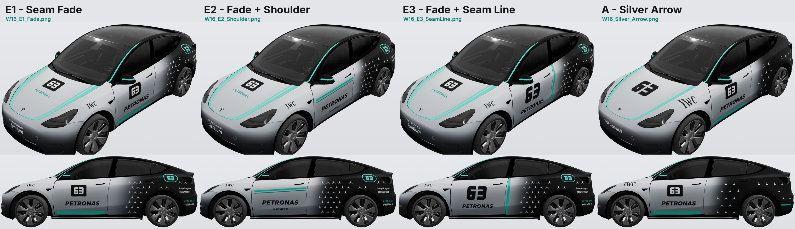
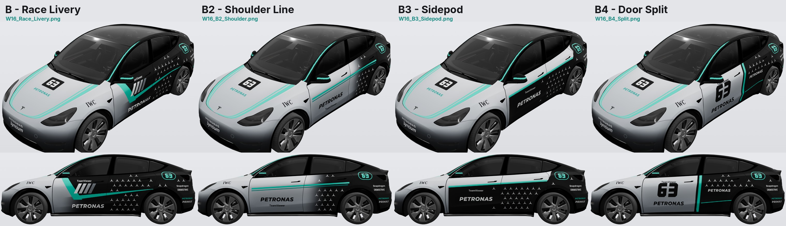

# Mercedes-AMG F1 W16 致敬車皮（舊款 Model Y）

以 2025 年 Mercedes-AMG PETRONAS F1 車隊 W16 E Performance（63 號）塗裝為靈感的自訂車皮，適用 **舊款 Model Y**（本儲存庫的 [`modely/`](../) 模板）。

<a href="preview/compare_e.jpg"></a>

### 最新：E 系列（車側漸層＋星芒）

車頭用 B 的風格（引擎蓋雙綠條＋63 號碼牌、前保桿由銀到深色漸層），車側是銀色前門、**從前後門接縫開始**往後漸層轉黑並鋪滿三芒星。

| | 檔案 | 前門 |
| --- | --- | --- |
| **E1** | [`W16_E1_Fade.png`](W16_E1_Fade.png) | 黑底 63 號碼牌＋PETRONAS，門底一條青綠直帶；漸層橫跨整個後門 |
| **E2** | [`W16_E2_Shoulder.png`](W16_E2_Shoulder.png) | 大型 PETRONAS，兩條青綠細線貼著肩線、停在門縫；漸層較短較快轉黑 |
| **E3** | [`W16_E3_SeamLine.png`](W16_E3_SeamLine.png) | 大號黑色 63＋PETRONAS；門縫上一條與接縫平行的青綠帶，標示漸層起點 |

### 其他版本

<a href="preview/compare.jpg"></a>

| | 檔案 | 風格 |
| --- | --- | --- |
| **A** | [`W16_Silver_Arrow.png`](W16_Silver_Arrow.png) | 簡潔版：銀色車頭、引擎蓋兩側寬版青綠邊帶與大號 63、前門 63 號碼牌與 PETRONAS、門底青綠直帶，後門起漸層轉黑並鋪滿三芒星 |
| **B** | [`W16_Race_Livery.png`](W16_Race_Livery.png) | 賽道版：青綠斜帶接直線流線、黑色側箱、進氣口斜槓、大型 PETRONAS、三芒星網格、後葉子板號碼圓牌與贊助商 |
| **C** | [`W16_Russell_63.png`](W16_Russell_63.png) | 號碼板版：前門白色面板＋大型 63、PETRONAS 與青綠底線，引擎蓋與前保桿同 B |
| **D** | [`W16_Black_Arrow.png`](W16_Black_Arrow.png) | 暗黑版：碳黑車身、銀色車鼻化為星陣、沿車門折線的青綠雙線與大型 63 |

<a href="preview/compare_b_sides.jpg"></a>

B 的三種車側變化（車頭車尾同 B）：**B2** [`W16_B2_Shoulder.png`](W16_B2_Shoulder.png) 肩線雙細線、**B3** [`W16_B3_Sidepod.png`](W16_B3_Sidepod.png) 肩線以下黑色側箱、**B4** [`W16_B4_Split.png`](W16_B4_Split.png) 沿前後門縫一刀切開。

### 所有版本共通

* **不透明**：車皮完全不透明，車子原本的車漆顏色不會透出來，套在任何顏色的車上看起來都一樣。
* **金屬質感從顏色來**：車機會把車皮當霧面貼膜打光，所以金屬感是畫進貼圖的，但不再在鈑金折線上畫亮線與反射（車頭看起來會怪）。改成銀色本身有明暗層次：車側由上往下從亮銀漸深到門檻，引擎蓋靠擋風玻璃與中央最亮、往車鼻與兩側邊緣漸深，前保桿由銀漸層到深色；再依車身大致的曲面加一層很柔和的明暗（朝天的面略亮、轉向地面的面略暗），沒有任何硬邊。
* **漸層**：有銀→黑漸層的版本，漸層都從前後門的接縫開始，前門保持全銀。
* **三芒星**：同一款每顆星在車上的大小、角度、亮度都一樣，一角朝正上方（依 3D 模型逐顆修正透視與曲面，在 3D 模型上實測：大小差異約 1%、角度偏差 2° 以內）。星芒不再淡入淡出：漸層只在車漆上，星芒從車漆夠暗的地方開始整顆出現。碰到接縫、邊緣、彎曲或折回處（例如尾翼下緣）以及文字的星會整顆略過；C 版車頂飾條上的小星已拿掉，避免出現不同大小的星。
* **後視鏡與 A 柱**：後視鏡黑底加一圈水平青綠線；A 柱黑色，中間一條細青綠線往上延伸到車頂前段（D 版是整條車頂飾條一條細線）。車頂飾條上沒有文字。
* **引擎蓋綠條**：從引擎蓋邊緣直接開始，不留白邊。
* **文字**：只保留贊助商（PETRONAS、IWC、TeamViewer、Snapdragon、CROWDSTRIKE 等），不放 AMG、Mercedes-Benz 等其他汽車品牌字樣。
* **車尾**：尾燈上方的尾翼與尾門橫帶沒有綠色裝飾，以星芒填滿；後保桿下方一條細綠線。

## 預覽

每一款在 [`preview/`](preview/) 都有兩張圖（`compare*.jpg` 為並排比較）：

* `*_3d.jpg`：把車皮檔上傳到 [Tesla Wrap Gallery 的 3D 視覺化工具](https://teslawrapgallery.com/visualizer/)（選「Model Y (Pre-2025)」）後，從左、右、前左、後左、正前、正後六個角度截的圖。上面的對比圖也是這樣來的。
* `*_sheet.png`：車皮檔在車身各面的平面投影（無光影）。

<a href="preview/W16_Race_Livery_3d.jpg"></a>

## 安裝

1. 下載想要的車皮檔（`modely/w16/` 底下的 `W16_*.png`，可以全放，上限 10 個）。**`preview/` 裡的圖只是預覽，不要放到車上。**
2. 傳到車上，二擇一：
   * **手機 App**（4.59.0 以上）：Creations → Wrap → Upload。請以「檔案」方式傳到手機（AirDrop、雲端硬碟等），不要經過會把圖片轉成 JPEG 的通訊軟體。
   * **USB 隨身碟**：格式化為 exFAT、FAT32（Mac 上叫 MS-DOS FAT）、ext3 或 ext4（**不支援 NTFS**），在根目錄建立名稱剛好是 `Wraps` 的資料夾，把 PNG 直接放進去；隨身碟內不要有地圖或韌體更新檔。
3. 車上：Toybox → Paint Shop → Wraps 分頁套用。若清單沒出現，重新插拔隨身碟再看一次。

## 符合 Tesla 規則

| 規則 | 本組檔案 |
| --- | --- |
| PNG 格式 | PNG、8-bit RGBA、非交錯、無多餘中繼資料 |
| 解析度 512–1024 px | 1024 × 1024，已是上限（與模板相同）；每個像素以 4×4 精確取樣並輕微銳化，在上限內盡量清晰 |
| 檔案大小 ≤ 1 MB | 約 450–560 kB |
| 檔名僅英數、底線、連字號、空白，≤ 30 字元 | 最長 `W16_Silver_Arrow.png`、`W16_B2_Shoulder.png` 等，含副檔名 20 字元以內 |
| 只塗模板白色區域 | 透明度與官方 `template.png` 逐像素相同（完全不透明） |

可用 `python3 tools/check.py modely/w16/*.png` 重新驗證。

## 想自己改

車皮是由 [`tools/`](../../tools/) 裡的程式產生的（說明見 [`tools/README.md`](../../tools/README.md)）：

```bash
bash tools/setup.sh                 # 第一次：安裝字型與 PNG 工具（Debian/Ubuntu）
python3 tools/build.py              # 重新產生全部版本與平面預覽
python3 tools/build.py --render     # 另外用 3D 視覺化工具重拍預覽（需要 node、Playwright 與網路）
```

例如想換成 12 號，把 `tools/designs/w16_a.py`（或 `w16_b.py`、`w16_c.py`、`w16_d.py`；B2–B4、E1–E3 共用 `w16_b_side.py`）裡的 `NUMBER = "63"` 改成 `"12"` 再重建即可。金屬感的強弱在 `tools/designs/w16_common.py`：車側銀色的明暗層次是 `SIDE_TONES`，整體柔和明暗是 `FINISH = tonal(...)`（`lo`、`hi` 拉開對比越強，`strength=0` 為純色）。

## 注意

* 3D 預覽來自第三方的視覺化工具，光影與車機不完全相同；最終效果請以車機或 Tesla App 為準。
* 車窗、玻璃車頂、輪圈與燈具不屬於可塗範圍。
* 這是粉絲致敬作品，僅供個人使用；Mercedes-AMG、PETRONAS 及各贊助商名稱與標誌為其各自所有者之商標。
