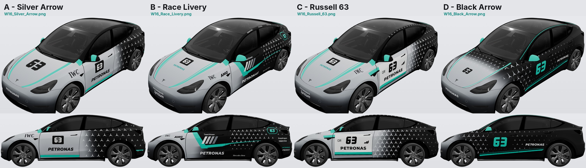
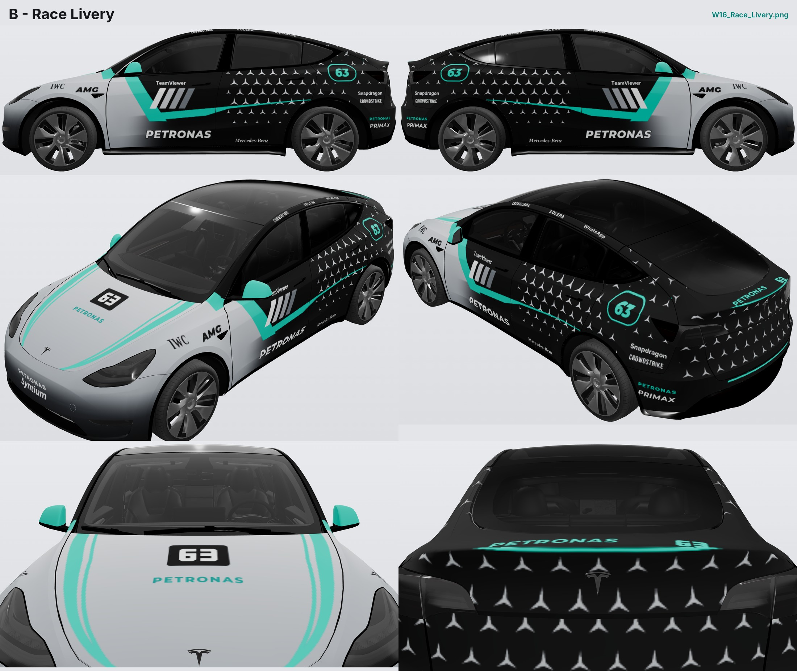

# Mercedes-AMG F1 W16 致敬車皮（舊款 Model Y）

以 2025 年 Mercedes-AMG PETRONAS F1 車隊 W16 E Performance（63 號）塗裝為靈感的自訂車皮，適用 **舊款 Model Y**（本儲存庫的 [`modely/`](../) 模板）。

<a href="preview/compare.jpg"></a>

| | 檔案 | 風格 |
| --- | --- | --- |
| **A** | [`W16_Silver_Arrow.png`](W16_Silver_Arrow.png) | 簡潔版：銀色車頭、引擎蓋兩側寬版青綠邊帶與大號 63、前門方塊字 63 號碼牌與 PETRONAS、沿車門底緣的青綠色直帶，後門起漸層轉黑並鋪滿三芒星 |
| **B** | [`W16_Race_Livery.png`](W16_Race_Livery.png) | 賽道版（車身取 3D 渲染參考圖、車頭取號碼牌參考圖）：青綠色斜帶接一條直線流線、黑色側箱、進氣口斜槓、大型 PETRONAS、三芒星網格、後葉子板號碼圓牌與贊助商字樣；引擎蓋兩側雙綠條＋63 號碼牌，前保桿銀到深色漸層配 PETRONAS Syntium |
| **C** | [`W16_Russell_63.png`](W16_Russell_63.png) | 號碼板版：前門白色面板＋大型方塊字 63、PETRONAS 與青綠底線，引擎蓋與前保桿同 B，半色調三芒星由銀漸變到黑 |
| **D** | [`W16_Black_Arrow.png`](W16_Black_Arrow.png) | 暗黑版：碳黑車身、銀色車鼻化為星陣、沿車門下緣折線的青綠雙線與大型 63 |

四款共通：青綠色線條都是直線，沿著板金的邊緣與折線走；引擎蓋往車鼻漸深，前保桿由銀色漸層到下緣的深色；A 柱與車頂飾條為黑色。

## 預覽

每一款在 [`preview/`](preview/) 都有兩張圖：

* `*_3d.jpg`：把車皮檔上傳到 [Tesla Wrap Gallery 的 3D 視覺化工具](https://teslawrapgallery.com/visualizer/)（選「Model Y (Pre-2025)」）後，從左、右、前左、後左、正前、正後六個角度截的圖。上面的對比圖也是這樣來的。
* `*_sheet.png`：車皮檔在車身各面的平面投影（無光影）。

<a href="preview/W16_Race_Livery_3d.jpg"></a>

## 安裝

1. 下載想要的車皮檔：`W16_Silver_Arrow.png`、`W16_Race_Livery.png`、`W16_Russell_63.png`、`W16_Black_Arrow.png`（可以全放，上限 10 個）。**`preview/` 裡的圖只是預覽，不要放到車上。**
2. 傳到車上，二擇一：
   * **手機 App**（4.59.0 以上）：Creations → Wrap → Upload。請以「檔案」方式傳到手機（AirDrop、雲端硬碟等），不要經過會把圖片轉成 JPEG 的通訊軟體。
   * **USB 隨身碟**：格式化為 exFAT、FAT32（Mac 上叫 MS-DOS FAT）、ext3 或 ext4（**不支援 NTFS**），在根目錄建立名稱剛好是 `Wraps` 的資料夾，把 PNG 直接放進去；隨身碟內不要有地圖或韌體更新檔。
3. 車上：Toybox → Paint Shop → Wraps 分頁套用。若清單沒出現，重新插拔隨身碟再看一次。

## 符合 Tesla 規則

| 規則 | 本組檔案 |
| --- | --- |
| PNG 格式 | PNG、8-bit RGBA、非交錯、無多餘中繼資料 |
| 解析度 512–1024 px | 1024 × 1024（與模板相同） |
| 檔案大小 ≤ 1 MB | 約 190–225 kB |
| 檔名僅英數、底線、連字號、空白，≤ 30 字元 | 最長 `W16_Silver_Arrow.png`，含副檔名 20 字元 |
| 只塗模板白色區域 | 透明度與官方 `template.png` 逐像素相同 |

可用 `python3 tools/check.py modely/w16/*.png` 重新驗證。

## 想自己改

車皮是由 [`tools/`](../../tools/) 裡的程式產生的（說明見 [`tools/README.md`](../../tools/README.md)）：

```bash
bash tools/setup.sh                 # 第一次：安裝字型與 PNG 工具（Debian/Ubuntu）
python3 tools/build.py              # 重新產生全部版本與平面預覽
python3 tools/build.py --render     # 另外用 3D 視覺化工具重拍預覽（需要 node、Playwright 與網路）
```

例如想換成 12 號，把 `tools/designs/w16_a.py`（或 `w16_b.py`、`w16_c.py`、`w16_d.py`）裡的 `NUMBER = "63"` 改成 `"12"` 再重建即可。

## 注意

* 3D 預覽來自第三方的視覺化工具，光影與車機不完全相同；最終效果請以車機或 Tesla App 為準。
* 車窗、玻璃車頂、輪圈與燈具不屬於可塗範圍。
* 這是粉絲致敬作品，僅供個人使用；Mercedes-AMG、PETRONAS 及各贊助商名稱與標誌為其各自所有者之商標。
